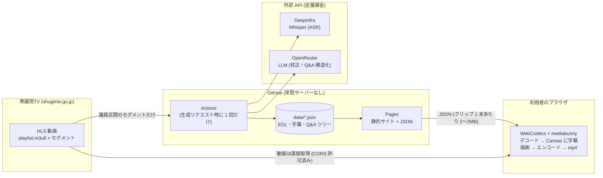

# autoclip

衆議院TV（衆議院インターネット審議中継 / shugiintv.go.jp）の委員会質疑から、特定の議員の質疑を SNS 用の縦型クリップにする Web アプリ。
字幕は焼き込み済み。フィラーと無音は JetCut で除き、Q&A 単位のトピックで切り出す。

- サイト: https://michitomo.github.io/autoclip/
- 操作: 日付 → 委員会 → 議員 → トピックを選ぶと、ブラウザ内で mp4 を書き出してダウンロードできる。

## 利用上の注意（重要）

本ツールは衆議院TV（shugiintv.go.jp）の映像を素材として扱います。**衆議院TV の利用規約・著作権の扱いは利用者ご自身で確認のうえ、各自の責任で利用してください。** 本リポジトリの提供者は、生成物の利用に関する許諾を保証するものではありません。

一般に、国会等での政治上の演説は著作権法第40条1項（公開された政治上の演説等の利用）の対象となり得ますが、適用可否・出所明示（同48条）等は個別事情によります。生成したクリップを公開・配布する場合は、出所（衆議院TV へのリンク等）を明示し、文脈を損なわない範囲で利用してください。切り抜きは公開前に人手でレビューすることを前提としています。

---

## しくみ：サーバー側のコストは「文字起こし」だけ

動画クリップ生成サービスを素直に作ると、次の処理をすべてサーバー側で行うことになります。

1. 元動画を衆議院TV からサーバーへダウンロード
2. サーバー上の FFmpeg でカット・字幕焼き込み・再エンコード
3. 完成した mp4 をサーバーから利用者へ配信

動画の転送量（egress）とエンコード用の CPU 時間は利用回数に比例して増えるので、無料・低予算で公開し続けるのは難しくなります。

autoclip では、**重い処理と動画の転送をすべて利用者のブラウザに寄せています。** サーバー側に残るのは、ブラウザでは十分な品質が出せない**文字起こし（ASR）と LLM による校正・構造化だけ**です。これも議員ごとに 1 回だけ実行し、結果を JSON としてキャッシュします。



### 1. 動画は衆議院TV からブラウザへ直接取得する

- 衆議院TV の HLS 配信（`hlsvod.shugiintv.go.jp/.../playlist.m3u8`）は CORS ヘッダ `Access-Control-Allow-Origin: *` を返すため、ブラウザの JavaScript から直接読めます。
- ブラウザは [mediabunny](https://mediabunny.dev/) の HLS 入力でプレイリストを開き、EDL の `keep_ranges`（残す区間）に当たる部分だけをデコードします。
- このサイトは**動画を保存も中継もしません**。GitHub Pages が配るのは HTML/JS と、クリップ 1 本あたり 1〜2MB 程度の JSON（`project.json` / `edl.json`）だけです。動画の転送量は衆議院TV からの直接配信分のみで、こちら側には発生しません。

### 2. レンダリングはブラウザ内の WebCodecs で行う

当初は FFmpeg.wasm（FFmpeg の WebAssembly 版）も検討しました。しかし wasm 版はネイティブ版より大幅に遅いため（PoC 時の見立てで 12〜25 倍）、ブラウザ組み込みの **WebCodecs** を使う方式にしました（検証コードは [`poc/webcodecs/`](poc/webcodecs/)）。WebCodecs は端末のハードウェアエンコーダを使えるので、FFmpeg.wasm より速く処理できます。

`frontend/src/render/compose.ts` の処理の流れ:

1. **デコード**: mediabunny が HLS から `keep_ranges` の区間だけ映像・音声サンプルを取り出す（FFmpeg の trim に相当）
2. **合成**: 9:16 の `OffscreenCanvas` に映像をセンタークロップで描き、字幕（質問者=ミント、答弁者=オレンジ、カラオケ式ハイライト、冒頭タイトル、上部の日付・委員会・議員バナー）を Canvas 2D で描画（サーバー版の libass 焼き込みに相当）
3. **エンコード**: `CanvasSource` → WebCodecs で H.264 にエンコード。音声も同じ区間を切り出して AAC（使えなければ Opus）で並行にエンコード
4. **mux**: mediabunny で mp4 にまとめ、Blob としてその場でダウンロード

カットは「member-WAV 時間（議員区間の先頭 = 0）+ `member_start`（セッション内での議員の開始秒）」で HLS 上の絶対時刻に換算して行います（`frontend/src/render/edl.ts`）。タイトルや字幕の文言はブラウザ上で編集してから書き出せますが、編集内容はサーバーに保存しません。

### 3. サーバー側（GitHub Actions）でやるのは文字起こしと構造化だけ

常駐サーバーは持たず、GitHub Actions がクリップ生成時にだけ動きます（`.github/workflows/build-pages.yml` → `backend/src/build_site.py`）。

1. 衆議院TV の HLS から**議員の発言区間に重なるセグメントだけ**を部分ダウンロード（数時間あるセッション全体は落とさない）
2. ランナー上のネイティブ FFmpeg で 16kHz mono の WAV を切り出す。使うのはここだけで、動画のレンダリングはしない
3. **DeepInfra `whisper-large-v3-turbo`** で語単位タイムスタンプ付きの文字起こし
4. **OpenRouter 経由の LLM** で議員名・政党名の校正、句読点の付与、Q&A ツリー化、要旨・トピック付け
5. JetCut（フィラー・無音除去）で EDL を作り、`project.json` / `edl.json` を `data/` にコミットして永続化

一度 `data/` に入った議員は二度と再生成しません。API の課金はクリップ 1 本につき 1 回だけで、閲覧数や書き出し回数には比例しません。毎時の cron は委員会・議員一覧（`corpus.json`）をスクレイプするだけで、ASR/LLM は呼ばず API キーも使いません。

### なぜ ASR はブラウザでやらないのか（苦肉の策）

ブラウザ標準の **Web Speech API（`SpeechRecognition`）** を使えば、文字起こしもブラウザ内で済み、**サーバー側コストは完全にゼロ**にできます。ただし次の理由で、ここだけはバックエンドから DeepInfra の Whisper を呼んでいます。

- **精度が足りない**: 国会審議の固有名詞（議員名・省庁名・法律名）や専門用語、長時間の音声では誤認識が多すぎて、字幕として公開できる水準にならない
- **語単位のタイムスタンプが取れない**: Web Speech API は認識テキストと信頼度しか返さない。JetCut（語の間の無音・フィラーを削る）とカラオケ字幕は語ごとの開始・終了時刻を前提にしているので、これがないと編集ができない

ブラウザ内 ASR の精度が上がれば、ここも移せる余地があります。

### コスト構造まとめ

| 処理 | 実行場所 | コスト |
| --- | --- | --- |
| 動画の配信 | 衆議院TV → 利用者のブラウザ（直接） | 0（中継しない） |
| デコード・字幕焼き込み・エンコード | 利用者のブラウザ（WebCodecs） | 0 |
| サイト・JSON の配信 | GitHub Pages | 無料 |
| 委員会・議員一覧のスクレイプ（毎時） | GitHub Actions | 無料（公開リポジトリ） |
| 部分ダウンロード・WAV 切り出し | GitHub Actions | 無料（公開リポジトリ） |
| 文字起こし（ASR） | DeepInfra Whisper | **従量課金**（クリップ 1 本につき 1 回） |
| 校正・Q&A 構造化・要旨 | OpenRouter LLM | **従量課金**（クリップ 1 本につき 1 回） |

---

## 使い方

1. [サイト](https://michitomo.github.io/autoclip/)で日付 → 委員会 → 議員を選ぶ
2. **生成済み（✓）の議員**: トピックを選ぶとブラウザ内でプレビューを書き出す。必要に応じてタイトル・字幕を直してから再書き出しし、mp4 をダウンロード
3. **未生成の議員**: 「生成リクエスト」から GitHub Issue（必要事項は入力済み）を作成する
   - `clip-request` ワークフローが Issue から `session_id` / `member` を読んで `targets.yml` に追記し、`build-pages` を起動する
   - 数分〜10 分ほどでサイトに反映され、書き出せるようになる

WebCodecs に対応したブラウザが必要です（最新の Chromium 系ブラウザを推奨）。書き出しは端末の性能に依存します。

## リポジトリ構成

```
autoclip/
  frontend/          # Vite + React + TS。GitHub Pages で配信する静的サイト
    src/render/      #   ブラウザレンダラ (compose.ts: WebCodecs/mediabunny, subtitle.ts: Canvas 字幕, edl.ts: 時間軸変換)
  backend/           # Python 3.12。スクレイプ → Whisper → LLM 構造化 → JetCut (EDL 生成)
    src/build_site.py    #   targets.yml の議員だけ生成して data/ に JSON を書く (Actions から実行)
    src/build_corpus.py  #   直近の委員会・議員一覧 corpus.json を作る (スクレイプのみ・API キー不要)
  data/              # 生成済みクリップの JSON (catalog.json + <session_id>_<議員名>/{project,edl}.json)
  targets.yml        # 生成対象の議員リスト (Issue から自動追記)
  .github/workflows/
    build-pages.yml  #   生成 → data/ をコミット → Pages にデプロイ (+ 毎時 corpus 更新)
    clip-request.yml #   clip-request Issue → targets.yml 追記 → build-pages 起動
  poc/webcodecs/     # WebCodecs レンダの PoC (FFmpeg.wasm との比較検証用)
```

`backend/src/app.py`（FastAPI）と `backend/src/video/renderer.py`（FFmpeg + libass によるサーバーレンダ）は、ローカルで動かしていた初期構成の名残です。現在の公開サイトはこれらを使いません。

## ローカル開発

### backend（クリップデータの生成・テスト）

```bash
cd backend
uv venv --python 3.12 .venv
uv pip install -e ".[dev]"
cp .env.example .env   # DEEPINFRA_API_KEY と OPENROUTER_API_KEY を設定
# ffmpeg が必要 (HLS の結合と WAV 切り出しに使う): brew install ffmpeg / apt install ffmpeg

# テスト (ネットワーク不要の純ロジック)
.venv/bin/python -m pytest -m "not integration" -q

# targets.yml の未生成議員を生成して data/ に書く (ASR/LLM 課金あり)
.venv/bin/python -m src.build_site --targets ../targets.yml --out ../data --work media/clips

# 委員会・議員一覧 (corpus.json) を作る (スクレイプのみ・課金なし)
.venv/bin/python -m src.build_corpus --out ../data --days 10
```

ASR は既定で DeepInfra `whisper-large-v3-turbo`。`ASR_PROVIDER=groq` で Groq に切り替えられます。LLM は OpenRouter 経由で、モデルは環境変数 `AUTOCLIP_LLM_MODEL` で変更できます。

### frontend（静的サイト）

```bash
cd frontend
ln -s ../../data public/data   # ローカルの data/ を静的配信 (gitignore 済み)
npm ci
npm run dev                    # http://localhost:5173
npm run build                  # 型チェック + ビルド
```
